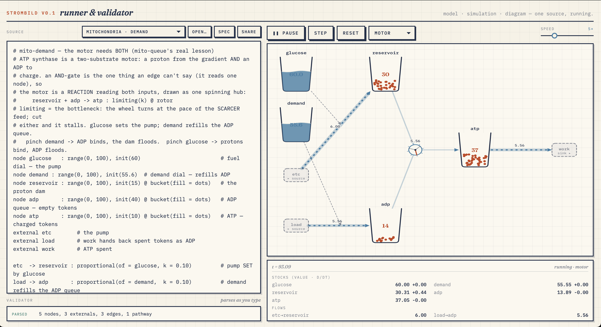

# Strombild

**A code-first language for stocks and flows that run.** Describe a system as
quantities that accumulate and flows that move between them; the same source is at
once the **model**, the **runnable simulation**, and the **diagram**.

*Strom* (current/flow) + *Bild* (picture): the picture of the flow.



*The runner on the `mito-demand` model: the source on the left is at once the model,
the running simulation, and the diagram on the right. ATP synthase is a two-substrate
motor drawn as a spinning hub — it turns at the pace of the scarcer feed, so starving
either the proton dam (`reservoir`) or the ADP queue stalls it. Edit the source and it
re-runs.*

```
node tub : range(0, 50)               # a stock that holds water
external tap                           # a boundary source
external drain                         # and a boundary sink
tap -> tub   : constant(c = 4)         # inflow: 4 units/sec
tub -> drain : proportional(k = 0.1)   # a leak proportional to depth
```

Open `index.html` in a browser, pick an example, and press play — the graph runs
forward and the picture moves. No build step, no dependencies.

## What makes it different

A model is a **graph**: nodes are stocks (things that accumulate), edges are flows
(things that move stuff between stocks), and every edge carries a **rate law** that
says how fast it flows. The engine walks the graph forward in time, one small step
at a time, accumulating flows into nodes. That walk *is* the simulation — there is
no separate "solver file" to keep in sync with the picture.

Because the same text runs and draws, it stays honest: you can't have a diagram
that disagrees with the model, because they're the same thing.

## Two channels: definition and visual

Every line has two optional annotation channels with the same grammar
`marker name(params)`:

- **`:` — definition.** What the thing fundamentally *is*. On a node, its range;
  on an edge, its rate law.
- **`@` — visual.** How it's *drawn*. A bucket filling with water, a pipe, a
  spinning rotor whose RPM tracks the flow.

Strip every `@` and the model still runs and is complete. Read every `@` and you
have the full rendering. They live on the same line as the thing they describe, so
they never drift apart.

```
node atp : range(0, 100) @ bucket(fill = dots)      # runs the same without the @
reservoir + adp -> atp : limiting(k = 2) @ rotor     # an AND-gate drawn as a motor
```

## The model is also analyzable

Because a model is a small, declared system, the language can reason about it
without you running the clock by hand:

- `equilibria()` / `knifeEdge()` — find the fixed points, and the tipping point
  between them, by scanning net rate.
- `fateScan(model, input, [readouts], {from})` — sweep one input across its range
  and report which stable state each readout latches into. `from: "lo" | "hi"`
  traces the two branches of a bistable switch's **hysteresis**.

A `threshold = auto` visual draws the *computed* knife-edge, so the picture can
never drift from the math.

## Quick start

```bash
./serve.sh                 # static server on localhost
# then open http://localhost:8000/index.html
```

Or open `index.html` directly. Run the tests (zero dependencies, Node's built-in
runner):

```bash
node --test
```

## What's in here

| Path | What it is |
| --- | --- |
| `strombild.js` | The **core** — parser + forward-Euler engine + layout + analysis (`equilibria`/`knifeEdge`/`fateScan`). No DOM. Runs in the browser (`window.Strombild`) or Node (`require`). The only place the language semantics live. |
| `strombild-render.js` | The **renderer** — draws the graph on a canvas: buckets that fill, pipes that flow, rotors that spin at the flow rate. Pure rendering over the core. |
| `strombild.md` | **The language reference** — full grammar, every rate law and visual, and the worked examples that forced each feature. Start here to go deep. |
| `strombild.test.js` | Node test suite. Covers the parser, engine numerics, analysis, and that the example models parse clean. |
| `index.html` | The **playground** — editor, live validator, canvas, examples menu, play/speed controls. |
| `player.html` | An embeddable **viewer** — `player.html?model=<name>.strombild[&play][&pathway=NAME][&editor=0]`. |
| `french-flag.html`, `french-flag-bistable.html` | Dedicated **fate-map** pages built on `fateScan` — one morphogen gradient read into three cell fates. |
| `examples/*.strombild` | Example models, from a leaky tub to bistable switches to physiology. |

## Examples worth opening first

- `examples/tub1.strombild` / `tub2.strombild` — a leaky tub. The baseline: one
  stock, one inflow, one leak.
- `examples/cafe.strombild` — a café that settles either empty or packed, with a
  tipping point between: bistability from a single `hill` inflow.
- `examples/gene-express.strombild` — a self-activating gene: the *same* bistable
  switch, wearing biology's clothes.
- `examples/french-flag.strombild` — one gradient + two thresholds → three fates.
- `examples/mitochondria.strombild` — producer → buffer → consumer, with the proton
  flux drawn as a spinning rotor (RPM ∝ flow).
- `examples/blood-pressure.strombild` — the baroreflex as stocks and flows: the
  mechanism, not just the number on the cuff.

## Embedding

A viewer loads any example by name; a bare filename resolves against `examples/`:

```html
<iframe src="player.html?model=cafe.strombild&play" width="100%" height="720"
        frameborder="0"></iframe>
```

Add `&editor=0` to hide the source panel, `&pathway=NAME` to run a named subset of
edges, `&speed=5` to set the rate.

## Design rule

Add a feature — a rate law, a visual, a keyword — only when a real model forces it.
Never speculatively. Each example is expected to expose the next gap, and ships as a
runnable model with tests, so the regression net grows with the language.

---

Strombild is one of a family of little languages that render biology as
engineering. The full design story lives in [`strombild.md`](strombild.md).
